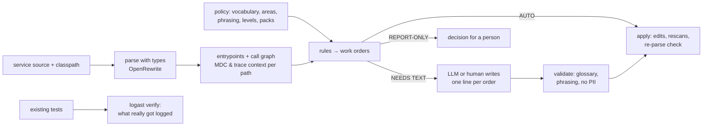

# logast

**Make every Spring Boot service log, trace and measure the same way, in your business's language,
without asking each team to remember the rules.**

logast reads a service's source with full type resolution, follows the call graph from every entrypoint (HTTP
endpoints, schedulers, listeners, batch runners) and finds where logging, MDC context, tracing and metrics fall
short of your standard. Each finding is a **work order**: a concrete, pre-decided code change. Most apply
automatically. Where a message has to be worded, a human or an LLM writes **one line of text**, and logast
checks it against your vocabulary and phrasing rules before writing anything.

What a service gets out of it:

- structured ECS JSON logs with `service.name` / `service.version`, and no hand-rolled `logback-spring.xml`;
- the business ids (`order.id`, `tenant.id`, …) in MDC from the entrypoint down, scoped with try-with-resources, and
  never leaking into the next request on a pooled thread;
- traces that survive `@Async`, executors, HTTP calls between services, Kafka, and orchestrator → batch-pod launches;
- log lines in one format and one vocabulary: `Payment charge failed [order.id=…]`, never
  `"Error while charging " + id`;
- exceptions logged once, where they are handled, and never swallowed silently;
- meter names and tags that don't explode your metrics backend;
- a compliance score per service, and CI that fails only on *new* problems.

Works with Spring Boot 4, SLF4J + Logback, OpenTelemetry (Micrometer Tracing), Gradle builds, Java 17+ services.
logast itself runs on Java 21+ (25 recommended).

---

## How it works



- **The tool decides, the writer only writes.** Where to log, at what level, which values, which MDC scope,
  which import: all of it is decided by logast. The LLM, or a person in `logast review`, only supplies message
  text, so the result is repeatable, cheap and safe to run in CI.
- **Paths, not single files.** "Is `order.id` in MDC here?" is answered for every path that reaches the line,
  across interfaces, lambdas, async hops and filters. A value already in MDC is never repeated in a message.
- **A runtime starter does the plumbing.** Generated code uses the small `logging-support` starter
  (`ObservedContext`, `MdcScope`, `ContextExecutors`, `TraceContextEnv`, a context-propagating `TaskDecorator`,
  MDC hygiene, ECS defaults). Pull it from your repository, or let logast copy it into the service
  (`support.mode: vendor`).

---

## Install

### From a release zip

```bash
unzip logast-0.1.0.zip -d ~/.local/share && ln -s ~/.local/share/logast-0.1.0/bin/logast ~/.local/bin/logast
logast --version
```

### From source

```bash
git clone https://github.com/magyar-attila-317/logast.git && cd logast
./install.sh --skill --starter
```

To update, pull and run `./install.sh` again: it rebuilds and replaces the installed copy (and refreshes the
Claude Code skill if it was installed). Add `--starter` when the starter changed.

**macOS:** the same steps work. Install a JDK first (`brew install openjdk@21`, or SDKMAN / Temurin) so `java` is
on PATH; the `/usr/bin/java` stub alone is not a JDK. `~/.local/bin` is not on the macOS PATH by default: add
`export PATH="$HOME/.local/bin:$PATH"` to `~/.zshrc`, or install elsewhere with `LOGAST_BIN=/opt/homebrew/bin ./install.sh`.

| option | what it does |
|---|---|
| *(none)* | builds the CLI, installs it to `~/.local/share/logast` and links `~/.local/bin/logast` |
| `--skill` | installs the Claude Code skill to `~/.claude/skills/logast/SKILL.md`, so Claude Code knows the workflow |
| `--starter` | publishes `dev.logast:logging-support` and `dev.logast:test-capture` to Maven Local (`~/.m2`) |
| `--zip <file>` | installs a release zip instead of building |

`LOGAST_HOME` / `LOGAST_BIN` override the install locations.

### Publish the starter to your company repository

```bash
./gradlew :logging-support:publish :test-capture:publish \
    -PrepoUrl=https://nexus.example.com/repository/maven-releases/ -PrepoUser=… -PrepoPassword=…
# or REPO_URL / REPO_USER / REPO_PASSWORD in the environment (CI)
```

Then point services at it in their policy: `support.coordinates: com.example:logging-support:0.1.0`.
The version comes from `gradle.properties`.

---

## Set up a service (once)

```bash
cd my-service
logast init                 # writes logast.yaml, .gitignore entries, .logast/classpath-*.txt and .logast/traffic.yaml
$EDITOR logast.yaml         # your business language: see below
```

`logast init` runs Gradle once to write the classpath (type resolution needs it; nothing is compiled), writes a
starter `logast.yaml` whose vocabulary is harvested from the code (see below),
ignores `.logast/` in git except the shared `baseline.json` and `traffic.yaml`, and lists every entrypoint in
`.logast/traffic.yaml` for you to fill in calls/day. Re-running it keeps existing files.

| option | what it does |
|---|---|
| `--extends <url\|file>` | company / area layers the policy builds on (comma-separated) |
| `--keep-wording` | legacy service: fix structure, keep existing message wording |
| `--pack logging,tracing,metrics` | rule packs (default `logging,tracing`) |
| `--baseline` | scan once and record today's findings, so CI fails only on new ones |
| `--no-classpath` / `--no-traffic` | skip those steps |
| `--force` | regenerate an existing `logast.yaml` |

The steps are also separate commands: `logast classpath .`, `logast traffic .`, `logast scan . --update-baseline`.

**The vocabulary starts from your code.** `init` (and `logast vocabulary .` at any time) collects every identifier the
service already uses: MDC keys, `[k=v]` / `k={}` keys in log messages, and id-like variables. Spellings of one
identifier become one term (`orderId`, `order_id`, `orderUuid` → `order`, key `order.id`), so you only reorganise:

```yaml
vocabulary:
  tenant:                # 1 / 25 / 283, 126 files            <- mdc / log / declared counts
    # roles in the code (other fields, not aliases): hostTenantId, jwtTenantId, requestedTenantId
    mdc: { key: tenant.id, aliases: [tenantId, tenant_id, tenantUuid], sources: { params: [tenantId, tenantUuid] } }
  "actor.user":          # 0 / 10 / 27, 23 files  <- a kind of "user"?
    mdc: { key: actor.user.id, aliases: [actorUserId], sources: { params: [actorUserId] } }

# Identifiers declared in the code that no log or MDC uses yet (declarations); add the ones that matter:
#   approver: approverUuid, approverId (90)
```

Rename terms, merge the ones flagged `a kind of` / `same as` when they are one concept, drop what isn't a business
term, and add banned words as `aliases`. With a company layer in `extends:`, only what it doesn't cover is listed.

A minimal `logast.yaml` that builds on a company layer:

```yaml
extends: [https://git.example.com/platform/observability/raw/main/company.yaml]

logging:
  rewriteExistingMessages: false   # legacy service: fix concatenation/glossary/lost exceptions, keep wording

vocabulary:
  order:
    aliases: [ordr]                # added to the company's aliases
```

The company layer is where the business language lives. See [`examples/restaurant-company.yaml`](examples/restaurant-company.yaml)
for a complete one (terms, aliases, MDC keys and their sources, areas where words mean something else, PII), and
[`docs/vocabulary.md`](docs/vocabulary.md) for how layers, overrides, phrasing and levels work.
`logast policy .` prints the merged result and every override.

---

## Examples

### 1. Scan

```
$ logast scan .
logast: 38 files, 9 entrypoints, 26/67 methods reachable, 27 call edges
45 orders: 34 AUTO, 4 NEEDS TEXT, 7 REPORT-ONLY
glossary terms: order, payment, charge, refund, shipment, customer, reconciliation

SWA-d5b58b  low  NEEDS TEXT  SWALLOWED_EXCEPTION  src/main/java/com/example/shop/service/DefaultOrderService.java:41
  PaymentException is caught and dropped without a log line in DefaultOrderService.place (documented as intentional)
  path: POST /orders → OrderController.create → DefaultOrderService.place
  + log.warn("{{MSG}}", order.id(){{ARGS}}, e);
  MSG: What failed and what happens next … | suffix keys: [order.id] | must read as '{subject} failed'
  note: PaymentClient.charge already logs this exception before rethrowing it. After this fix that log becomes
        an EXCEPTION_LOGGED_TWICE order to delete (log once, where it is handled).

DOM-f22aa2  medium  AUTO  MISSING_DOMAIN_MDC  src/main/java/com/example/shop/web/OrderController.java:37
  GET /orders/{orderId}: MDC lacks order.id
  + try (var mdc = MdcScope.of("order.id", orderId)) {
  + … (4 lines)
```

`--rule`, `--pack logging|tracing|metrics`, `--severity high`, `--entrypoint "POST /orders"` and `--limit` narrow the
list. `--format json|summary|sarif|fills-template` change the output.

### 2. What the fixes look like

An identifier repeated in every message of a method goes into MDC once (REPEATED_LOG_VALUE), and the messages lose
the now redundant `[k=v]`:
```java
public void refund(String orderId, long amountCents) {
    try (var mdc = MdcScope.of("order.id", orderId)) {
        log.info("Refund started");
        check(amountCents);
        log.info("Refund completed [amount.cents={}]", amountCents);
    }
}
```

Swallowed exception, written text in **bold**:
```java
} catch (PaymentException e) {
    log.warn("Payment charge failed, reconciliation job will retry [order.id={}]", order.id(), e);
```

Entrypoint the framework doesn't trace (`@EventListener`, custom listeners), with the ids from its parameters:
```java
ObservedContext observed = ObservedContext.entrypoint("inbox-processor.handle")
        .mdc("order.id", event.orderId()).start();
try (observed) {
    ...
} catch (Throwable t) {
    observed.error(t);
    throw t;
} finally {
    observed.stop();
}
```

`MDC.put` / `finally { MDC.clear(); }` (which also wipes the caller's context) becomes:
```java
try (var mdc = MdcScope.of("audit.action", action, "tenant.id", tenantId)) {   // alias tenantId → tenant.id
    log.info("Audit entry written");
}
```

Context lost on a thread hand-off:
```java
private final ExecutorService executor = ContextExecutors.wrap(Executors.newFixedThreadPool(2));
```

Traces across services and processes:
```java
public ShippingClient(RestClient.Builder restClientBuilder) {         // was RestClient.builder()
    this.client = restClientBuilder.baseUrl("http://shipping-service").build();
}
pb.environment().putAll(TraceContextEnv.current());                    // orchestrator → batch job pod/process
```

Messages:
```diff
- log.info("Placed purchase " + order.id());
+ log.info("Placed order [order.id={}]", order.id());
- log.warn("Refund failed for order {}", orderId);            // order.id is already in MDC; exception was lost
+ log.warn("Refund failed", e);
- log.info("Starting reconciliation for tenant {}", tenant);
+ log.info("Reconciliation for tenant {} started", tenant);
```

### 3. Let an LLM finish it

With the skill installed (`./install.sh --skill`), ask Claude Code *"bring this service's logging to the
standard"*. It follows [`docs/llm-workflow.md`](docs/llm-workflow.md):

```bash
logast scan . --format fills-template > fills.json      # LLM fills only the empty "MSG" values
logast apply . --auto --fills fills.json                # dry run: diff + REJECTED reasons
logast apply . --auto --fills fills.json --write
logast scan .                                           # until only REPORT-ONLY remains
```

In a trial on the sample app, an LLM working only from the docs finished in one round: it wrote 4 lines of text,
38 orders were applied, and nothing was rejected.

### 4. Let a person finish it

```bash
logast review . --open
```

This opens a local page (127.0.0.1, token-protected) with one input per message. It shows the code, the path
from the entrypoint, the required phrasing and the suffix keys. *Dry run* shows the diff and any rejections;
*Apply* writes.

### 5. Check what the tests really log

```
$ logast verify .
verify: 2 log events from tests; 2 of 23 log statements exercised (8%)
RTL-dace69  high  REPORT-ONLY  RUNTIME_TRACE_LOST  …/notification/Mailer.java:12  Mailer.send
  No traceId here, although the same test had one on thread 'Test worker': the work moved to thread
  'pool-1-thread-1' without its trace
RNV-5ecdae  medium  REPORT-ONLY  RUNTIME_NULL_VALUE  …/notification/Mailer.java:12
  A logged value rendered as 'null'
```

It runs your existing tests (the build isn't changed; an init script adds the capture jar), records every log
event, and reports context that existed in a test and then got lost, plus values logged as `null`.

By default it runs `./gradlew test`. Services with other test tasks set them in `logast.yaml` (or pass
`--tasks "test intTest bddTest"`):

```yaml
verify:
  tasks: [test, intTest, bddTest]   # or [check]
  gradleDir: ../..                  # optional: run Gradle from the repo root (service is a subproject)
```

### 6. Noise: logs in loops, and real volume

`LOG_IN_LOOP` flags an INFO line per collection element, skipping loops over enums and fixed lists. With rates
in `.logast/traffic.yaml` (`logast traffic .` lists every entrypoint for you; a Prometheus query result works
too), `LOG_VOLUME` reports lines/day per statement over your budget. logast never guesses traffic.

### 7. CI

```bash
logast scan . --baseline --fail-on high --format summary         # only findings that aren't in the baseline
logast scan . --since origin/main --format sarif > logast.sarif  # changed lines only, as PR annotations
```

A complete GitHub Actions job is in [`examples/github-actions.yml`](examples/github-actions.yml).

### 8. Across all services

```bash
logast fleet services/*/ --out fleet-report       # fleet-report/fleet.html, with trend against the last run
```

---

## Commands

| command | what it does |
|---|---|
| `logast init [svc]` | one-time setup: policy, .gitignore, classpath, traffic template (`--baseline` for CI) |
| `logast vocabulary [svc]` | draft vocabulary harvested from the code, only terms the policy doesn't cover yet (`--all`: everything) |
| `logast classpath <svc>` | runs Gradle once and writes `.logast/classpath-*.txt` (compiles nothing) |
| `logast scan <svc>` | finds gaps, writes `.logast/orders.json`, prints the work orders |
| `logast apply <svc> [--auto] [--fills f] [--only ids] [--write]` | applies orders on a scratch copy, rescanning between rounds; dry run unless `--write` |
| `logast review <svc> [--open]` | local page for people to write the messages and apply |
| `logast verify <svc>` | runs the existing tests with log capture and checks what was really logged |
| `logast explain <svc> [--entrypoint "POST /x"]` | lists entrypoints, or the call tree below one with log/MDC/async markers |
| `logast traffic <svc>` | writes `.logast/traffic.yaml` with every entrypoint, ready to fill in |
| `logast fleet <svc>…` | compliance report across services |
| `logast policy <svc>` | the effective policy after all layers, with overrides |
| `logast rules` | every rule and its packs |

Common options: `--policy <file>`, `--classpath-file <file>`, `--pack <packs>`, `--traffic <file>`.

## Rules

| pack | rules |
|---|---|
| logging | SWALLOWED_EXCEPTION · LOST_THROWABLE · LOG_AND_RETHROW · EXCEPTION_LOGGED_TWICE · STRING_CONCAT_LOG · LOG_FORMAT · GLOSSARY_VIOLATION · MESSAGE_PHRASING · LOG_KEY_STYLE · PII_IN_LOG · REPEATED_LOG_VALUE · LOG_LEVEL · LOG_IN_LOOP · LOG_VOLUME · MDC_NOT_CLOSEABLE · MDC_KEY_ALIAS · MISSING_DOMAIN_MDC · AREA_MDC_MISSING · ENTRYPOINT_SILENT · SETUP_LOGBACK_XML · SETUP_STRUCTURED_LOGGING |
| tracing | ENTRYPOINT_NOT_OBSERVED · HTTP_CLIENT_UNTRACED · KAFKA_OBSERVATION_DISABLED · JOB_LAUNCH_UNTRACED · MANUAL_TRACE_MDC · SETUP_OTEL_STARTER |
| logging + tracing | ASYNC_CONTEXT_LOSS · SETUP_SUPPORT_STARTER |
| metrics (opt-in) | METRIC_NAMING · METRIC_HIGH_CARDINALITY_TAG · METRIC_DIRECT_REGISTRY |
| runtime (`verify`) | RUNTIME_TRACE_LOST · RUNTIME_MDC_LOST · RUNTIME_NULL_VALUE |

Suppress a single finding with `// logast:ignore RULE` on the line or the line above. Tune or disable rules in the
policy (`rules: { LOG_FORMAT: { severity: low } }`, `{ enabled: false }`).

## The runtime starter

| | `support.mode: dependency` (default) | `support.mode: vendor` |
|---|---|---|
| what logast does | adds `dev.logast:logging-support` to `build.gradle(.kts)` | copies its classes into `<app package>.logging` |
| upgrades | bump the version | re-copy, or switch to the dependency later |
| when | you publish the starter to your repository | no shared artifact yet, or the service must not take new dependencies |

Both give the same generated code. The starter also protects services that logast never touched:
- `MdcHygieneFilter` clears and reports MDC that leaks across requests;
- the `TaskDecorator` carries MDC and trace context into `@Async` and Spring executors;
- batch apps continue the trace from `TRACEPARENT` / `TRACE_ID`;
- logs default to ECS JSON with `SERVICE_NAME` / `APP_VERSION`.

## Troubleshooting

| symptom | cause and fix |
|---|---|
| `WARNING: no classpath` or many unresolved calls | run `logast classpath .`; rerun it after adding dependencies (e.g. after the starter was added) |
| `logast classpath` fails | it only resolves dependencies; run the printed Gradle command without `-q` to see why |
| `REJECTED … must read as '{subject} failed'` | the text has to follow the lifecycle form for that log, e.g. "Payment charge failed, will retry" |
| `REJECTED … glossary 'purchase' → use 'order'` | use the vocabulary term; `logast policy .` shows aliases |
| `depends on [SUP-…]` | apply that order in the same run (`--auto` does) |
| scans are slow on large services | the first scan parses everything (about 30 s for 2,000 files); with compiled classes on the classpath, apply rounds re-parse only changed files |

## Development

```bash
./gradlew build              # all modules and tests (core, logging-support, test-capture)
./gradlew :cli:installDist   # cli/build/install/logast/bin/logast
./gradlew :cli:distZip       # release zip with docs, examples and the Claude Code skill
```

| module | contents |
|---|---|
| `core` | parsing, call graph and path context, policy loader, rules, work orders, apply, verify, fleet, review |
| `cli` | the `logast` command |
| `logging-support` | the runtime starter used by generated code |
| `test-capture` | log capture added to test runs by `logast verify` |
| `fixtures/sample-app` | a shop app with planted gaps; `// expect: RULE` markers are checked exactly by the tests |

## Known limitations

- Gradle builds only. Kotlin sources and reactive (WebFlux) code are not analysed.
- Calls into libraries end the call graph; whatever happens inside a library is not followed.
- Existing `MDC.putCloseable` calls are left as they are (they remove instead of restore).
- `LOG_VOLUME` is only as good as the traffic numbers you provide.
