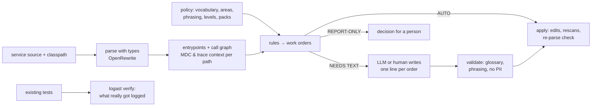

# logast

**Make every Spring Boot service log, trace, measure, fail and audit the same way, in your business's language,
without asking each team to remember the rules.**

logast reads a service's source with full type resolution, follows the call graph from every entrypoint (HTTP
endpoints, schedulers, listeners, batch runners) and finds where logging, MDC context, tracing and metrics fall
short of your standard. Each finding is a **work order**: a concrete, pre-decided code change. Most apply
automatically. Where a message has to be worded, a human or an LLM writes **one line of text**, and logast
checks it against your vocabulary and phrasing rules before writing anything.

What a service gets out of it:

- structured ECS JSON logs with `service.name` / `service.version`, and no hand-rolled `logback-spring.xml`;
- the business ids (`order.id`, `tenant.id`, …) in MDC from the entrypoint down, scoped with try-with-resources, and
  never leaking into the next request on a pooled thread;
- traces that survive `@Async`, executors, HTTP calls between services, Kafka, and orchestrator → batch-pod launches;
- log lines in one format and one vocabulary: `Payment charge failed [order.id=…]`, never
  `"Error while charging " + id`;
- exceptions logged once, where they are handled, and never swallowed silently;
- meter names and tags that don't explode your metrics backend, and business events that are measured;
- timeouts on every outgoing call, bounded thread pools, Kafka records that are not silently dropped;
- error responses that don't leak internals, and business exceptions that don't turn into 500s;
- an audit record for every action that must have one;
- a compliance score per service, and CI that fails only on *new* problems.

Works with Spring Boot 4, SLF4J + Logback, OpenTelemetry (Micrometer Tracing), Gradle builds, Java 17+ services.
logast itself runs on Java 21+ (25 recommended).

---

## How it works



- **The tool decides, the writer only writes.** Where to log, at what level, which values, which MDC scope,
  which import: all of it is decided by logast. The LLM, or a person in `logast review`, only supplies message
  text, so the result is repeatable, cheap and safe to run in CI.
- **Paths, not single files.** "Is `order.id` in MDC here?" is answered for every path that reaches the line,
  across interfaces, lambdas, async hops and filters. A value already in MDC is never repeated in a message.
- **A runtime starter does the plumbing.** Generated code uses the small `logging-support` starter
  (`ObservedContext`, `MdcScope`, `ContextExecutors`, `TraceContextEnv`, a context-propagating `TaskDecorator`,
  MDC hygiene, ECS defaults). Pull it from your repository, or let logast copy it into the service
  (`support.mode: vendor`).

---

## Install

### From a release zip

```bash
unzip logast-0.1.0.zip -d ~/.local/share && ln -s ~/.local/share/logast-0.1.0/bin/logast ~/.local/bin/logast
logast --version
```

### From source

```bash
git clone https://github.com/magyar-attila-317/logast.git && cd logast
./install.sh --skill --starter
```

To update, pull and run `./install.sh` again: it rebuilds and replaces the installed copy (and refreshes the
Claude Code skill if it was installed). Add `--starter` when the starter changed.

**macOS:** the same steps work. Install a JDK first (`brew install openjdk@21`, or SDKMAN / Temurin) so `java` is
on PATH; the `/usr/bin/java` stub alone is not a JDK. `~/.local/bin` is not on the macOS PATH by default: add
`export PATH="$HOME/.local/bin:$PATH"` to `~/.zshrc`, or install elsewhere with `LOGAST_BIN=/opt/homebrew/bin ./install.sh`.

| option | what it does |
|---|---|
| *(none)* | builds the CLI, installs it to `~/.local/share/logast` and links `~/.local/bin/logast` |
| `--skill` | installs the Claude Code skill to `~/.claude/skills/logast/SKILL.md`, so Claude Code knows the workflow |
| `--starter` | publishes `dev.logast:logging-support` and `dev.logast:test-capture` to Maven Local (`~/.m2`) |
| `--zip <file>` | installs a release zip instead of building |

`LOGAST_HOME` / `LOGAST_BIN` override the install locations.

### Publish the starter to your company repository

```bash
./gradlew :logging-support:publish :test-capture:publish \
    -PrepoUrl=https://nexus.example.com/repository/maven-releases/ -PrepoUser=… -PrepoPassword=…
# or REPO_URL / REPO_USER / REPO_PASSWORD in the environment (CI)
```

Then point services at it in their policy: `support.coordinates: com.example:logging-support:0.1.0`.
The version comes from `gradle.properties`.

---

## Set up a service (once)

### 1. Run `logast init` in the service's folder

```
$ cd my-service
$ logast init --key-style camel
logast init  /home/me/my-service
Sets up this service once. Re-running keeps what you already edited.

  ✓ logast.yaml             your settings: which checks run, key style, and 36 business terms found in the code (review them)
  ✓ .gitignore              ignores .logast/, but keeps baseline.json, traffic.yaml and README.md shared
  ✓ .logast/README.md       explains every file in .logast/ and which ones go into git
  ✓ .logast/classpath-*.txt 263 jars and class folders (8.1s): lets logast understand types
  ✓ .logast/traffic.yaml    845 entrypoints; optional: add calls/day so logast can judge log volume
  · .logast/baseline.json   not recorded (add --baseline, or later `logast scan . --update-baseline`)

Next steps
  1. open logast.yaml                 rename/merge the business terms; the comments explain every setting
  2. logast scan . --format summary   what logast would change, per rule
  3. logast apply . --auto            preview the automatic fixes (add --write to change files)
```

### What `init` creates, and why

| file | what it is for | in git? | when you touch it |
|---|---|---|---|
| `logast.yaml` | your settings: which checks run, how keys are spelled, your business words. Every option is explained in comments inside the file | yes | right after `init`, then rarely |
| `.logast/classpath-*.txt` | the service's compile classpath. logast needs it to understand types; Gradle runs once, nothing is compiled | no (machine-specific paths) | run `logast classpath .` again after changing dependencies |
| `.logast/traffic.yaml` | every entrypoint, with calls per day if you fill them in; used to judge log volume | yes | optional; refresh the list with `logast traffic .` |
| `.logast/baseline.json` | today's findings, so CI fails only on new ones (`--baseline`) | yes | when you accept the current state |
| `.logast/fills.json` | message texts for findings that need one; `logast scan` creates and updates it, `logast apply` uses it | no | when you (or an LLM) write messages |
| `.logast/README.md` | the same explanation, inside the folder | yes | never |

`init` options:

| option | what it does |
|---|---|
| `--extends <url\|file>` | build on your company's shared settings (comma-separated) |
| `--key-style camel` | spelling of MDC and `[k=v]` keys: `dotted` (default), `camel`, `pascal`, `snake` |
| `--keep-wording` | legacy service: fix structure, keep the wording of existing messages |
| `--support vendor` | copy `MdcScope` / `ObservedContext` into the service instead of adding the library (until it is in your Nexus) |
| `--pack logging,tracing,metrics` | which checks run (default `logging,tracing`; also `metrics`, `resilience`, `errors`, `audit`) |
| `--baseline` | scan once and record today's findings for CI |
| `--no-classpath` / `--no-traffic` | skip those steps |
| `--force` | write a fresh `logast.yaml` over an existing one |

Each step is also its own command: `logast classpath .`, `logast traffic .`, `logast scan . --update-baseline`.

### 2. Review `logast.yaml`

The file explains itself: every setting has a comment, and optional ones are there as switched-off examples. The
full list, with defaults, is in **[docs/configuration.md](docs/configuration.md)**. `logast policy .` shows the final
settings after all layers are merged.

**The vocabulary starts from your code.** `init` (and `logast vocabulary .` at any time) collects every identifier the
service already uses: MDC keys, `[k=v]` / `k={}` keys in log messages, and id-like variables. Spellings of one
identifier become one term (`orderId`, `order_id`, `orderUuid` → `order`, key `order.id`), so you only reorganise:

```yaml
vocabulary:
  tenant:                # 1 / 25 / 283, 126 files            <- mdc / log / declared counts
    # roles in the code (other fields, not aliases): hostTenantId, jwtTenantId, requestedTenantId
    mdc: { key: tenant.id, aliases: [tenantId, tenant_id, tenantUuid], sources: { params: [tenantId, tenantUuid] } }
  "actor.user":          # 0 / 10 / 27, 23 files  <- a kind of "user"?
    mdc: { key: actor.user.id, aliases: [actorUserId], sources: { params: [actorUserId] } }

# Identifiers declared in the code that no log or MDC uses yet (declarations); add the ones that matter:
#   approver: approverUuid, approverId (90)
```

Rename terms, merge the ones flagged `a kind of` / `same as` when they are one concept, drop what isn't a business
term, and add banned words as `aliases`. With a company layer in `extends:`, only what it doesn't cover is listed.

A minimal `logast.yaml` that builds on a company layer:

```yaml
extends: [https://git.example.com/platform/observability/raw/main/company.yaml]

logging:
  rewriteExistingMessages: false   # legacy service: fix concatenation/glossary/lost exceptions, keep wording

vocabulary:
  order:
    aliases: [ordr]                # added to the company's aliases
```

The company layer is where the business language lives. See [`examples/restaurant-company.yaml`](examples/restaurant-company.yaml)
for a complete one (terms, aliases, MDC keys and their sources, areas where words mean something else, PII), and
[`docs/vocabulary.md`](docs/vocabulary.md) for how layers, overrides, phrasing and levels work.
`logast policy .` prints the merged result and every override.

### 3. Scan, then apply

```bash
logast scan . --format summary      # what would change, per rule
logast scan .                       # every finding, with a preview of the change
logast apply . --auto               # preview the automatic fixes (a diff); nothing is written
logast apply . --auto --write       # make them
```

Findings come in three kinds: **AUTO** (logast fixes it), **NEEDS TEXT** (someone writes one message: put it into
`.logast/fills.json` and `apply` picks it up), and **REPORT-ONLY** (a decision for a person; the note says what to
decide).

`.logast/fills.json` follows the code by itself: `scan` and `apply` create it when it is missing, keep every entry you
already have exactly as it is, add entries for new findings and remove the ones that are done. Nothing is rewritten
when nothing changed.

Output is coloured in a terminal. `NO_COLOR=1` turns colours off, `LOGAST_COLOR=always|never` forces them.


---

## Examples

### 1. Scan

```
$ logast scan .
logast: 38 files, 9 entrypoints, 26/67 methods reachable, 27 call edges
45 orders: 34 AUTO, 4 NEEDS TEXT, 7 REPORT-ONLY
glossary terms: order, payment, charge, refund, shipment, customer, reconciliation

SWA-d5b58b  low  NEEDS TEXT  SWALLOWED_EXCEPTION  src/main/java/com/example/shop/service/DefaultOrderService.java:41
  PaymentException is caught and dropped without a log line in DefaultOrderService.place (documented as intentional)
  path: POST /orders → OrderController.create → DefaultOrderService.place
  + log.warn("{{MSG}}", order.id(){{ARGS}}, e);
  MSG: What failed and what happens next … | suffix keys: [order.id] | must read as '{subject} failed'
  note: PaymentClient.charge already logs this exception before rethrowing it. After this fix that log becomes
        an EXCEPTION_LOGGED_TWICE order to delete (log once, where it is handled).

DOM-f22aa2  medium  AUTO  MISSING_DOMAIN_MDC  src/main/java/com/example/shop/web/OrderController.java:37
  GET /orders/{orderId}: MDC lacks order.id
  + try (var mdc = MdcScope.of("order.id", orderId)) {
  + … (4 lines)
```

`--rule`, `--pack logging|tracing|metrics`, `--severity high`, `--entrypoint "POST /orders"` and `--limit` narrow the
list. `--format json|summary|sarif|fills-template` change the output.

### 2. What the fixes look like

An identifier repeated in every message of a method goes into MDC once (REPEATED_LOG_VALUE), and the messages lose
the now redundant `[k=v]`:
```java
public void refund(String orderId, long amountCents) {
    try (var mdc = MdcScope.of("order.id", orderId)) {
        log.info("Refund started");
        check(amountCents);
        log.info("Refund completed [amount.cents={}]", amountCents);
    }
}
```

Swallowed exception, written text in **bold**:
```java
} catch (PaymentException e) {
    log.warn("Payment charge failed, reconciliation job will retry [order.id={}]", order.id(), e);
```

Entrypoint the framework doesn't trace (`@EventListener`, custom listeners), with the ids from its parameters:
```java
ObservedContext observed = ObservedContext.entrypoint("inbox-processor.handle")
        .mdc("order.id", event.orderId()).start();
try (observed) {
    ...
} catch (Throwable t) {
    observed.error(t);
    throw t;
} finally {
    observed.stop();
}
```

`MDC.put` / `finally { MDC.clear(); }` (which also wipes the caller's context) becomes:
```java
try (var mdc = MdcScope.of("audit.action", action, "tenant.id", tenantId)) {   // alias tenantId → tenant.id
    log.info("Audit entry written");
}
```

Context lost on a thread hand-off:
```java
private final ExecutorService executor = ContextExecutors.wrap(Executors.newFixedThreadPool(2));
```

Traces across services and processes:
```java
public ShippingClient(RestClient.Builder restClientBuilder) {         // was RestClient.builder()
    this.client = restClientBuilder.baseUrl("http://shipping-service").build();
}
pb.environment().putAll(TraceContextEnv.current());                    // orchestrator → batch job pod/process
```

Messages:
```diff
- log.info("Placed purchase " + order.id());
+ log.info("Placed order [order.id={}]", order.id());
- log.warn("Refund failed for order {}", orderId);            // order.id is already in MDC; exception was lost
+ log.warn("Refund failed", e);
- log.info("Starting reconciliation for tenant {}", tenant);
+ log.info("Reconciliation for tenant {} started", tenant);
```

What goes into a log line:
```java
log.info("Coupon batch received [couponIds={}]", couponIds);   // LOG_COLLECTION_ARGUMENT → [couponCount={}], couponIds.size()
log.info("Order attached [order={}]", order);                  // LOG_OBJECT_ARGUMENT → order.id(): no toString of a whole
                                                                //   DTO/entity (lazy loading = a query inside a log call)
log.info("Loaded [customer={}]", ticket.getCustomer().getName()); // reported: navigates a lazy association, may NPE
log.info("No Coupon entries found, won't publish");           // MESSAGE_VAGUE → "No coupon entries found, will not publish"
log.debug("Processing...");                                    // MESSAGE_VAGUE (reported): say what started/completed/failed
LogHelper.logCollection(log, "Prepared", items);               // LOG_HELPER (reported): log at the call site instead
```
Collections with a fixed size (`List.of(..)`, constants, enum sets, `limit(..)`) are left alone. A value record of counts,
or a class with its own `toString()`, is not an object dump.

MDC is owned once, where the flow starts:
```java
try {                                     // legacy block one call below an entrypoint that scopes couponId already:
    MDC.put(COUPON_ID, couponId);         //   MDC_NOT_CLOSEABLE + MDC_NESTED_KEY + MDC_CLEAR → the whole block goes,
    log.info("Calculation started");      //   the log lines stay, the entrypoint's scope carries the context
} finally {
    MDC.clear();                          // MDC_CLEAR: never wipe the caller's context (trace ids included)
}
```
`static final` key constants are understood; the generated scope keeps the constant. No new scope or observation is
added around code that still writes MDC the old way: the MDC fix comes first, the wraps follow after the rescan.

Messages that alerts or dashboards depend on are never reworded or reformatted:
```yaml
logging:
  protectedMessages: ["^ALERT:", "Payment reconciliation mismatch"]   # regexes; reported, not rewritten
  vagueMessages: ["^handled\\.?$"]                                  # added to the built-in avoid-list
```

Where logs are missing (log coverage): logast adds the line, someone writes the sentence.
```java
@Scheduled(cron = "0 0 2 * * *")
public void export() {
    log.info("Invoice export started");                              // ENTRYPOINT_SILENT
    List<Invoice> open = invoices.findBySentFalse();
    if (open.isEmpty()) {
        log.info("Invoice export skipped, no open invoices");        // SKIP_UNLOGGED: why nothing happened
        return;
    }
    sender.sendAll(open);
    log.info("Invoice export completed");                            // JOB_OUTCOME_MISSING
}

public void sendAll(List<Invoice> open) {
    for (Invoice invoice : open) {
        send(invoice);
    }
    log.info("Invoice batch completed [invoiceCount={}]", open.size()); // BATCH_SUMMARY_MISSING
}

public Invoice cancel(String invoiceId) {
    var result = invoices.save(new Invoice(invoiceId, null, false)); // a returned value is extracted first,
    log.info("Invoice cancelled [invoiceId={}]", result.id());      // STATE_CHANGE_UNLOGGED, so it can be logged
    return result;
}
```
- **Jobs and listeners** (scheduled, batch runners, Kafka/JMS/Rabbit, event and WebSocket handlers) get an outcome
  line; scheduled and batch runs also a start line. HTTP requests are left out: access logs and `http.server.requests`
  already show them.
- **Skipped work**: an early `return` in a job or the methods it calls directly (INFO in scheduled/batch runs,
  DEBUG elsewhere). Only `void` methods: an early return that hands back a value is logic, not a skip.
- **State changes**: a repository save/delete in a method that logs nothing; the entity's id is logged.
- **Batch summaries**: a loop on a job path that does I/O per item (repository, HTTP, messaging). Loops over a call
  (`for (Order o : repository.findAll())`) get the call extracted into a variable first, so the count doesn't run
  the query again.

The scan's header shows the service's **log coverage**, the share of these places that already log:
```
log coverage 53.7% (jobs 68/214 · http 409/631 · skips 0/50 · stateChanges 174/310 · loops 14/33)
```
It is also a column in the fleet report. Turn single rules off with `rules: { SKIP_UNLOGGED: { enabled: false } }`.

### 3. Let an LLM finish it

With the skill installed (`./install.sh --skill`), ask Claude Code *"bring this service's logging to the
standard"*. It follows [`docs/llm-workflow.md`](docs/llm-workflow.md):

```bash
logast scan .                       # also writes .logast/fills.json: the LLM fills in the empty "MSG" values
logast apply . --auto               # dry run: diff + REJECTED reasons (uses .logast/fills.json)
logast apply . --auto --write
logast scan .                       # until only REPORT-ONLY remains
```

In a trial on the sample app, an LLM working only from the docs finished in one round: it wrote 4 lines of text,
38 orders were applied, and nothing was rejected.

### 4. Let a person finish it

```bash
logast review . --open
```

This opens a local page (127.0.0.1, token-protected) with one input per message. Texts already in
`.logast/fills.json` are filled in, and what you type is saved there. It shows the code, the path
from the entrypoint, the required phrasing and the suffix keys. *Dry run* shows the diff and any rejections;
*Apply* writes.

### 5. Check what the tests really log

```
$ logast verify .
verify: 2 log events from tests; 2 of 23 log statements exercised (8%)
RTL-dace69  high  REPORT-ONLY  RUNTIME_TRACE_LOST  …/notification/Mailer.java:12  Mailer.send
  No traceId here, although the same test had one on thread 'Test worker': the work moved to thread
  'pool-1-thread-1' without its trace
RNV-5ecdae  medium  REPORT-ONLY  RUNTIME_NULL_VALUE  …/notification/Mailer.java:12
  A logged value rendered as 'null'
```

It runs your existing tests (the build isn't changed; an init script adds the capture jar), records every log
event, and reports context that existed in a test and then got lost, plus values logged as `null`.

By default it runs `./gradlew test`. Services with other test tasks set them in `logast.yaml` (or pass
`--tasks "test intTest bddTest"`):

```yaml
verify:
  tasks: [test, intTest, bddTest]   # or [check]
  gradleDir: ../..                  # optional: run Gradle from the repo root (service is a subproject)
```

### 6. Noise: logs in loops, and real volume

INFO once per loop item is fine for 10 items and a flood for 50,000, so logast judges by where the items come from
(`levels.infoInLoops: size`, the default):

| loop over | INFO per item |
|---|---|
| a fixed list, enum values, a constant, up to `boundedLoopMax` (20) items | fine |
| database rows (repository `find…`/`stream…`, JDBC queries, pages), file lines, a Kafka batch | lowered to DEBUG (LOG_LEVEL); the batch-summary rule adds one total after the loop |
| anything else (size unknown) | reported (LOG_IN_LOOP); a comment above the loop settles it |

```java
// logast:loop-size 10       (or small): INFO stays
// logast:loop-size large    DEBUG, plus a summary after the loop
for (Store store : stores) { ... }
```

`never` lowers every loop that isn't known to be small, `always` turns the checks off. With rates
in `.logast/traffic.yaml` (`logast traffic .` lists every entrypoint for you; a Prometheus query result works
too), `LOG_VOLUME` reports lines/day per statement over your budget. logast never guesses traffic.

### 7. CI

```bash
logast scan . --baseline --fail-on high --format summary         # only findings that aren't in the baseline
logast scan . --since origin/main --format sarif > logast.sarif  # changed lines only, as PR annotations
```

A complete GitHub Actions job is in [`examples/github-actions.yml`](examples/github-actions.yml).

### 8. Metrics (opt-in pack)

Turn it on with `packs: [logging, tracing, metrics]`. A business event that is logged but not measured gets an
Observation, which gives a timer (count, duration, errors) and a span in one:
```java
public void refund(String orderId, long amountCents) {
    ObservedContext observed = ObservedContext.entrypoint("refund").start();
    try (observed) {
        log.info("Refund started");
        …
        log.info("Refund completed");
    } catch (Throwable t) { observed.error(t); throw t; } finally { observed.stop(); }
}
```
A business event is a method logging "X started" / "X completed" (the phrasing rules), where X names a vocabulary
term or the method logs the full lifecycle. HTTP endpoints, `@Scheduled` methods and observed Kafka listeners are
already timed by Spring and left alone.

Tags get a vocabulary like MDC keys (aliases are renamed, `values` optionally restricts literal values):
```yaml
metrics:
  tags:
    outcome: { aliases: [result, success, succeeded], values: [success, failure] }
```
It also catches what silently breaks metrics: one meter name registered with different tag keys (Prometheus drops the
later ones), gauges on objects nothing else references (they read NaN after GC), meters built per loop item, ids or
PII as tags. `logast metrics .` lists every meter, and the fleet report compares them across services: same name with
different types/tags, and similar names (`orders.placed` vs `order_placed`).

### 9. Resilience, errors and audit (opt-in packs)

Turn them on with `packs: [logging, tracing, metrics, resilience, errors, audit]` (or `scan --pack resilience`).
They use the same entrypoint and call-path analysis, so a finding says *which request* is affected.

**resilience**: what turns a slow or failing dependency into an outage.

| rule | finds | fix |
|---|---|---|
| HTTP_CLIENT_NO_TIMEOUT | Spring HTTP clients with no connect/read timeout (Boot sets none); JDK `HttpClient` without `connectTimeout` | AUTO: `spring.http.clients.connect-timeout` / `read-timeout` (policy `resilience.*`, default 5s / 30s) |
| KAFKA_NO_ERROR_HANDLER | listeners on the default handling: 9 immediate retries, then the record is skipped | report: `DefaultErrorHandler` + `DeadLetterPublishingRecoverer` + backoff |
| UNBOUNDED_EXECUTOR | `newCachedThreadPool`, `newFixedThreadPool` (unbounded queue), `ThreadPoolTaskExecutor` without queue capacity | report |
| BLOCKING_WAIT_UNBOUNDED | `future.get()`, `join()`, `latch.await()` without timeout on a request/message path | report |

**errors**: what an HTTP client sees when something goes wrong.

| rule | finds | fix |
|---|---|---|
| ERROR_DETAILS_EXPOSED | `server.error.include-message/stacktrace/exception`; a handler for unexpected exceptions copying `e.getMessage()` into the body | AUTO for the config (set to never), report for handlers |
| UNMAPPED_EXCEPTION | an application exception thrown on an HTTP path that no `@ExceptionHandler` or `@ResponseStatus` maps (it becomes a 500) | report: decide its status |
| CLIENT_ERROR_AS_SERVER_ERROR | a handler answering 500 for a validation / not-found / denied exception | report |
| PROBLEM_DETAILS_DISABLED | Spring MVC errors are not RFC 9457 `ProblemDetail` responses | report (changes the API's error body) |

**audit**: actions that must leave an audit record, not just a log line.

| rule | finds |
|---|---|
| AUDIT_MISSING | an entrypoint matching `audit.actions` from which no audit emitter is reachable |
| AUDIT_SECURITY_EVENTS | Spring Security in use, but failed/successful logins and denied access are not recorded |

```yaml
audit:
  emitters: [com.example.audit.AuditService, com.example.audit.ActivityLogger#log]
  actions:                       # defaults: DELETE endpoints, /admin/**, export/delete/grant/revoke/refund/approve… methods
    - http: "* /api/payments/**"
    - term: refund               # a vocabulary term in the endpoint or method name
```
With no emitters listed, any call on a type named `*Audit*`, or passing an `*Audit*` argument (an `AuditAction`
value, an event implementing `AuditableDomainEvent`), counts as recording an audit event.

### 10. Across all services

```bash
logast fleet services/*/ --out fleet-report       # fleet-report/fleet.html, with trend against the last run
```

---

## Commands

| command | what it does |
|---|---|
| `logast init [svc]` | one-time setup: policy, .gitignore, classpath, traffic template (`--baseline` for CI) |
| `logast metrics [svc]` | every meter the service publishes: name, type, tag keys, where (`--format json`) |
| `logast vocabulary [svc]` | draft vocabulary harvested from the code, only terms the policy doesn't cover yet (`--all`: everything) |
| `logast classpath <svc>` | runs Gradle once and writes `.logast/classpath-*.txt` (compiles nothing) |
| `logast scan <svc>` | finds gaps, writes `.logast/orders.json`, prints the work orders |
| `logast apply <svc> [--auto] [--only ids] [--write]` | applies orders on a scratch copy, rescanning between rounds; dry run unless `--write`. Message texts come from `.logast/fills.json` (or `--fills <file>`) |
| `logast review <svc> [--open]` | local page for people to write the messages and apply |
| `logast verify <svc>` | runs the existing tests with log capture and checks what was really logged |
| `logast explain <svc> [--entrypoint "POST /x"]` | lists entrypoints, or the call tree below one with log/MDC/async markers |
| `logast traffic <svc>` | writes `.logast/traffic.yaml` with every entrypoint, ready to fill in |
| `logast fleet <svc>…` | compliance report across services |
| `logast policy <svc>` | the effective policy after all layers, with overrides |
| `logast rules` | every rule and its packs |

Common options: `--policy <file>`, `--classpath-file <file>`, `--pack <packs>`, `--traffic <file>`.

## Rules

| pack | rules |
|---|---|
| logging | SWALLOWED_EXCEPTION · LOST_THROWABLE · LOG_AND_RETHROW · EXCEPTION_LOGGED_TWICE · STRING_CONCAT_LOG · LOG_FORMAT · GLOSSARY_VIOLATION · MESSAGE_PHRASING · MESSAGE_VAGUE · LOG_KEY_STYLE · PII_IN_LOG · LOG_OBJECT_ARGUMENT · LOG_COLLECTION_ARGUMENT · LOG_HELPER · REPEATED_LOG_VALUE · LOG_KEY_VALUE_IN_MDC · JOB_OUTCOME_MISSING · SKIP_UNLOGGED · STATE_CHANGE_UNLOGGED · BATCH_SUMMARY_MISSING · LOG_LEVEL · LOG_IN_LOOP · LOG_VOLUME · MDC_NOT_CLOSEABLE · MDC_CLEAR · MDC_NESTED_KEY · MDC_KEY_ALIAS · MISSING_DOMAIN_MDC · AREA_MDC_MISSING · ENTRYPOINT_SILENT · SETUP_LOGBACK_XML · SETUP_STRUCTURED_LOGGING |
| tracing | ENTRYPOINT_NOT_OBSERVED · HTTP_CLIENT_UNTRACED · KAFKA_OBSERVATION_DISABLED · JOB_LAUNCH_UNTRACED · MANUAL_TRACE_MDC · SETUP_OTEL_STARTER · TRACING_SAMPLING |
| logging + tracing | ASYNC_CONTEXT_LOSS · SCHEDULED_TASK_UNTRACED · SETUP_SUPPORT_STARTER |
| resilience (opt-in) | HTTP_CLIENT_NO_TIMEOUT · KAFKA_NO_ERROR_HANDLER · UNBOUNDED_EXECUTOR · BLOCKING_WAIT_UNBOUNDED |
| errors (opt-in) | ERROR_DETAILS_EXPOSED · UNMAPPED_EXCEPTION · CLIENT_ERROR_AS_SERVER_ERROR · PROBLEM_DETAILS_DISABLED |
| audit (opt-in) | AUDIT_MISSING · AUDIT_SECURITY_EVENTS |
| metrics (opt-in) | BUSINESS_EVENT_UNMEASURED · METRIC_NAMING · METRIC_TAG_KEY · METRIC_TAG_VALUE · METRIC_TAG_KEYS_MISMATCH · METRIC_HIGH_CARDINALITY_TAG · METRIC_GAUGE_WEAK_REF · METRIC_REGISTERED_PER_CALL · METRIC_DIRECT_REGISTRY |
| runtime (`verify`) | RUNTIME_TRACE_LOST · RUNTIME_MDC_LOST · RUNTIME_NULL_VALUE |

Suppress a single finding with `// logast:ignore RULE` on the line or the line above. Tune or disable rules in the
policy (`rules: { LOG_FORMAT: { severity: low } }`, `{ enabled: false }`).

## The runtime starter

| | `support.mode: dependency` (default) | `support.mode: vendor` |
|---|---|---|
| what logast does | adds `dev.logast:logging-support` to `build.gradle(.kts)` | copies its classes into `<app package>.logging` |
| upgrades | bump the version | re-copy, or switch to the dependency later |
| when | you publish the starter to your repository | no shared artifact yet, or the service must not take new dependencies |

Both give the same generated code. The starter also protects services that logast never touched:
- `MdcHygieneFilter` clears and reports MDC that leaks across requests;
- the `TaskDecorator` carries MDC and trace context into `@Async` and Spring executors;
- batch apps continue the trace from `TRACEPARENT` / `TRACE_ID`;
- logs default to ECS JSON with `SERVICE_NAME` / `APP_VERSION`.

## Troubleshooting

| symptom | cause and fix |
|---|---|
| `WARNING: no classpath` or many unresolved calls | run `logast classpath .`; rerun it after adding dependencies (e.g. after the starter was added) |
| `logast classpath` fails | it only resolves dependencies; run the printed Gradle command without `-q` to see why |
| `REJECTED … must read as '{subject} failed'` | the text has to follow the lifecycle form for that log, e.g. "Payment charge failed, will retry" |
| `REJECTED … glossary 'purchase' → use 'order'` | use the vocabulary term; `logast policy .` shows aliases |
| `depends on [SUP-…]` | apply that order in the same run (`--auto` does) |
| scans are slow on large services | the first scan parses everything (about 30 s for 2,000 files); with compiled classes on the classpath, apply rounds re-parse only changed files |

## Development

```bash
./gradlew build              # all modules and tests (core, logging-support, test-capture)
./gradlew :cli:installDist   # cli/build/install/logast/bin/logast
./gradlew :cli:distZip       # release zip with docs, examples and the Claude Code skill
```

| module | contents |
|---|---|
| `core` | parsing, call graph and path context, policy loader, rules, work orders, apply, verify, fleet, review |
| `cli` | the `logast` command |
| `logging-support` | the runtime starter used by generated code |
| `test-capture` | log capture added to test runs by `logast verify` |
| `fixtures/sample-app` | a shop app with planted gaps; `// expect: RULE` markers are checked exactly by the tests |

## Known limitations

- Gradle builds only. Kotlin sources and reactive (WebFlux) code are not analysed.
- Calls into libraries end the call graph; whatever happens inside a library is not followed.
- Existing `MDC.putCloseable` calls are left as they are (they remove instead of restore).
- LOG_OBJECT_ARGUMENT judges by type: a project class logged whole is reported unless it is a value record or defines
  `toString()`; library types are only flagged when they are known payloads (headers, requests, JSON, records).
- `LOG_VOLUME` is only as good as the traffic numbers you provide.
- AUDIT_MISSING follows direct calls only: an audit written by a listener of a published event counts when the event
  (or what it carries) is audit-typed, but not when the listener alone decides to audit.
- UNMAPPED_EXCEPTION treats a controller's own `@ExceptionHandler` as global, and ignores exceptions from libraries.
