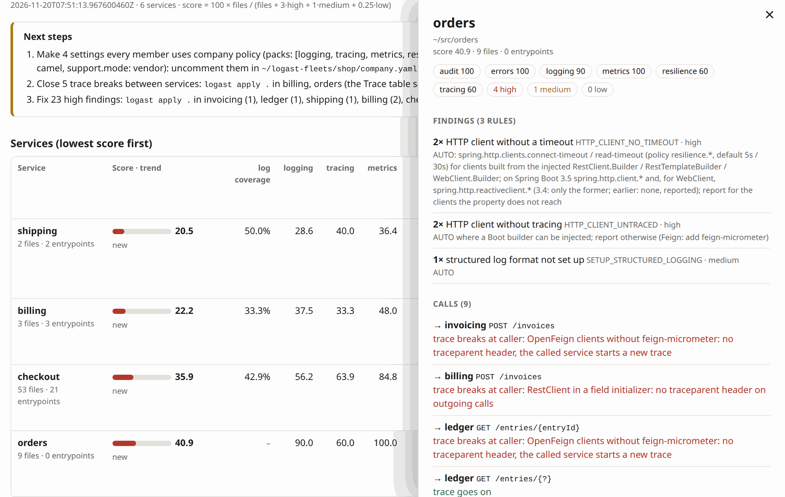
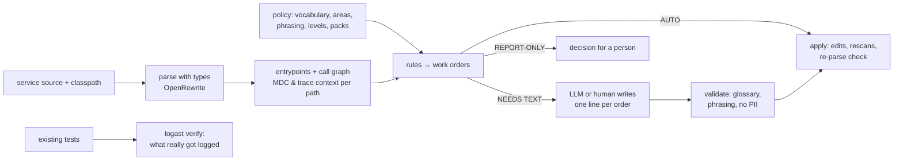

# logast

**One standard for how every Spring Boot service logs, traces, measures, fails and audits, written into the code
itself, rolled out across all your services, and a map of the whole system your LLM can ask.**

[](https://github.com/magyar-attila-317/logast/actions/workflows/build.yml)
[](LICENSE)


logast reads your services the way a careful reviewer would, with full type resolution and every path from every
entrypoint, and does three things with what it finds:

| | |
|---|---|
| **Brings a service up to the standard**<br>`logast apply .` | Over a hundred rules in six packs (logging, tracing, metrics, resilience, errors, audit), fixed in the code: business ids in MDC from the entrypoint down, traces that survive threads, messaging and launched jobs, timeouts, counted outcomes, audit records. It knows every kind of entrypoint a Spring service has: HTTP and functional routes, Kafka, RabbitMQ, JMS, SQS, Redis, Spring Integration, Stream, gRPC, WebSockets, `@Scheduled`, Quartz, Spring Batch, application events. The result compiles, and a second run changes nothing. |
| **Keeps a whole fleet there**<br>`logast fleet` | One overview of every service: scores, the call that loses the trace between two services, the same business id under three different keys, the settings everyone already agrees on. A CI gate that fails only on new problems. A governed rollout: the company policy is versioned in git, each repo decides whether it takes part, and the change arrives as a branch and a pull request you review stage by stage. |
| **Maps the system for you and your LLM**<br>`logast mcp` | A knowledge base of what the code and the deployments actually say: endpoints, jobs and when they run per environment, the tables each one reads and writes, topics and queues, Helm and Terraform deployments, secrets, CI workflows. Any MCP client can ask *who writes this table*, *what runs Monday in prod*, *what stops if this service is down*, and every answer cites the file and line it comes from. |

It reads Java and Spring, Flyway and TypeORM migrations, Helm, Terraform and Terragrunt, GitHub Actions workflows and
Ansible inventories: what the code and the configuration state, not what someone wrote down.

<table>
<tr><th>Before</th><th>After <code>logast apply .</code></th></tr>
<tr>
<td>

```java
log.info("Pledge allotment started [pledgeId={}]",
        request.code());
sender.send(request.code());
log.info("Pledge allotment completed [pledgeId={}, tableId={}]",
        request.code(), request.tableId());
```

</td>
<td>

```java
try (var mdc = MdcScope.of("pledgeId", request.code())) {
    log.info("Pledge allotment started");
    sender.send(request.code());
    log.info("Pledge allotment completed [tableId={}]",
            request.tableId());
}
```

</td>
</tr>
</table>

Every line of the operation now carries `pledgeId`, including the lines logged by the code it calls.
[More before/after examples](docs/examples.md), one per pack.

---

## One command

```bash
logast apply .     # or ./gradlew logastApply
git diff           # review, commit
```

Nothing has to be set up or published first. The first `apply` reads the classpath, writes a `logast.yaml` that
explains itself, copies the few support classes the new code needs into your service, and leaves a migration that
compiles. What it cannot decide alone (the wording of a message, whether to count an outcome) has a safe default and
waits in `logast review` for when you get to it.

[Install](docs/install.md): `git clone … && ./install.sh` (Java 21+).

---

## What it fixes

| pack | in one line |
|---|---|
| [logging](docs/packs/logging.md) | one message format and vocabulary; exceptions logged once and never swallowed; business ids in MDC from the entrypoint down; silent flows get a line |
| [tracing](docs/packs/tracing.md) | the trace survives `@Async`, executors, HTTP, messaging and launched jobs; trace ids in every log line |
| [metrics](docs/packs/metrics.md) | business outcomes are counted; meter names and tags stay bounded |
| [resilience](docs/packs/resilience.md) | timeouts on every outgoing call, bounded pools and waits, retries that actually run, graceful shutdown |
| [errors](docs/packs/errors.md) | error responses that don't leak internals, the right status codes, the trace id in the body |
| [audit](docs/packs/audit.md) | an audit record for every action that needs one: who, what, outcome, written after commit |

All six packs are on by default. Each finding is either fixed (**AUTO**), waits for one line of text (**NEEDS TEXT**),
or is reported with what to decide (**REPORT-ONLY**). [Every rule](docs/rules.md).

---

## Five ways in

### 1. A service team: `apply`, review, done

`logast apply .` makes the changes; `logast review . --open` opens a local page with the open choices: the code, the
path from the entrypoint and one input per message, metric or retry. Apply again and it is finished.
[Commands](docs/commands.md).

### 2. An LLM writes the messages

logast decides *where* to log, at what level, with which values and MDC scope. The LLM only writes the text, and logast
checks it against your vocabulary and phrasing rules before writing anything. With `./install.sh --skill`, ask Claude
Code *"bring this service's logging to the standard"*. It also works across every service of a fleet.
[The loop it follows](docs/llm-workflow.md).

### 3. CI: annotations on the pull request, a gate on new findings

```yaml
- run: logast scan . --since origin/${{ github.base_ref }} --format github --fail-on high
```

Findings on the lines a PR changed show up on its diff, on any GitHub plan (no code scanning needed), with a summary on
the run's page. With a committed baseline, CI fails only on *new* problems. Or use `./gradlew logastCheck`.
[CI and the Gradle plugin](docs/gradle-plugin.md).

### 4. A platform team: the whole fleet on one page

List your repos in a git repo of their own, and logast scans them all, without touching them:

```bash
logast fleet init my-company        # in a new repo: repos.yaml, README, GitHub workflow
$EDITOR repos.yaml                  # the repo URLs
git push                            # the workflow scans every repo; the report goes to Pages when you switch it on
```



- **Next steps** at the top: what to do first, each step with its exact command.
- **Scores per service and pack**, a daily trend, and the most frequent rules in plain words.
- **Trace breaks between services**: which call loses the trace id, and which side has to fix it.
- **One company policy**: the settings all members already agree on, ready to make official in `company.yaml`.
- **One vocabulary**: the same business id under different keys in different services, to decide once.
- **A drawer per service**: its findings, its calls, where each call goes.
- **A governed rollout**: `logast fleet tag-policy` versions the company policy, `logast fleet rollout` plans, applies,
  commits and opens the pull request per repo, stage by stage, and a repo's own `logast.yaml` says whether it takes part.

[Fleets](docs/fleet.md) · [For platform teams](docs/platform.md) (company policy, central vocabulary, publishing the
support library).

### 5. Ask an LLM about all your repos: the knowledge base over MCP

Questions no single repo answers, asked in your IDE's assistant or any MCP client:

- *Which jobs write to `billing.invoice`, and which of them run on Mondays in prod?*
- *Who reads the `order-events` topic, and which service publishes to it?*
- *If the `ledger` service is down, what stops working downstream?*
- *Where is the `PAYMENTS_DB_PASSWORD` secret used, and when does it expire?*

```bash
logast fleet . --refresh --kb               # in the fleet repo: every repo's facts into kb/ (the workflow does it nightly)
logast mcp config --kb ~/src/my-company/kb  # the server entry for your MCP client
```

logast reads the facts from the code and the deployment files themselves: Spring (endpoints, listeners, `@Scheduled` and
Quartz jobs with their cron per environment, the tables JPA and JDBC touch), Flyway migrations, Helm, Terraform and
GitHub workflows. Every answer cites the repo, file and line it comes from, and says what it does not know instead of
answering "never". With `--code-mode`, the LLM gets two tools instead of twenty: a typed API, and a read-only JavaScript
sandbox where one program answers what would take a dozen lookups.
[The MCP server](docs/mcp.md) · [What the facts are](docs/facts.md).

---

## How it works



- **The tool decides, the writer only writes.** Placement, level, values, MDC scope and imports are decided by logast,
  so the result is repeatable, cheap and safe to run in CI.
- **Paths, not single files.** "Is `order.id` in MDC here?" is answered for every path that reaches the line: across
  interfaces, lambdas, async hops and filters.
- **A small runtime library does the plumbing.** Each behaviour is off until a property switches it on, and logast
  writes the ones it uses. [The starter](docs/starter.md).

**Works with** Spring Boot 3 and 4 on Java 17+, Gradle, SLF4J + Logback, Micrometer Tracing / OpenTelemetry. logast
itself runs on Java 21+ (25 recommended).

---

## Documentation

| page | what is in it |
|---|---|
| [install](docs/install.md) | install options, updating, macOS, building from source |
| [examples](docs/examples.md) | before/after code per pack |
| [commands](docs/commands.md) | every command, its options, example output, the `.logast` folder, exit codes |
| [rules](docs/rules.md) | every rule: severity, what it finds, how it is fixed |
| [configuration](docs/configuration.md) | every `logast.yaml` setting |
| [vocabulary](docs/vocabulary.md) | vocabulary, policy layers, phrasing, levels, log volume |
| [gradle-plugin](docs/gradle-plugin.md) | `logastApply`, `logastCheck`, SARIF and PR annotations |
| [fleet](docs/fleet.md) | many services: the overview, the report page, the fleet repo, the rollout |
| [mcp](docs/mcp.md) | the knowledge base over MCP: setup, what it answers, code mode, `knowledge.yml` |
| [facts](docs/facts.md) | what `logast export` reads from code and deployments, and the facts format |
| [architecture](docs/architecture.md) | discover, derive, map: what logast reads, what it infers, what your mappings add |
| [platform](docs/platform.md) | company policy, central vocabulary, publishing the support library |
| [starter](docs/starter.md) | the runtime library and its properties |
| [llm-workflow](docs/llm-workflow.md) | the loop an LLM follows (installed as the Claude Code skill) |
| [troubleshooting](docs/troubleshooting.md) | symptoms, fixes, known limitations |

Contributing: [AGENTS.md](AGENTS.md) (issues, a failing test per change, the e2e matrix) and
[building from source](docs/install.md#development).

## License

[Apache License 2.0](LICENSE): use, fork, change and redistribute it, also commercially. Copies and derivative works
keep the license and the [NOTICE](NOTICE) file, which names logast as their source, and say what they changed.
