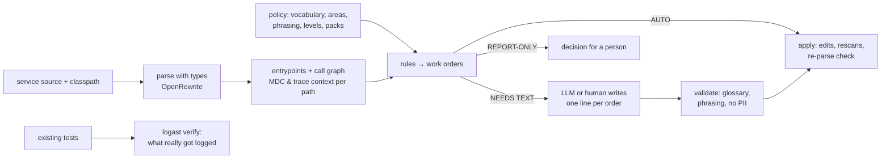

# logast

**Every Spring Boot service logs, traces, measures, fails and audits the same way, in your business's language, and
nobody has to remember the rules.**

[](https://github.com/magyar-attila-317/logast/actions/workflows/build.yml)
[](LICENSE)


logast reads your service's code with full type resolution, follows every path from the entrypoints (HTTP, Kafka,
schedulers, batch jobs) and rewrites what falls short: business ids in MDC, traces across threads and services, timeouts,
metrics and log lines in one format. It changes the code itself, and the result compiles.

<table>
<tr><th>Before</th><th>After <code>logast apply .</code></th></tr>
<tr>
<td>

```java
log.info("Coupon redemption started [couponId={}]",
        request.code());
sender.send(request.code());
log.info("Coupon redemption completed [couponId={}, tableId={}]",
        request.code(), request.tableId());
```

</td>
<td>

```java
try (var mdc = MdcScope.of("couponId", request.code())) {
    log.info("Coupon redemption started");
    sender.send(request.code());
    log.info("Coupon redemption completed [tableId={}]",
            request.tableId());
}
```

</td>
</tr>
</table>

Every line of the operation now carries `couponId`, including the lines logged by the code it calls.
[More before/after examples](docs/examples.md), one per pack.

---

## One command

```bash
logast apply .     # or ./gradlew logastApply
git diff           # review, commit
```

Nothing has to be set up or published first. The first `apply` reads the classpath, writes a `logast.yaml` that
explains itself, copies the few support classes the new code needs into your service, and leaves a migration that
compiles. What it cannot decide alone (the wording of a message, whether to count an outcome) has a safe default and
waits in `logast review` for when you get to it.

[Install](docs/install.md): `git clone … && ./install.sh` (Java 21+).

---

## What it fixes

| pack | in one line |
|---|---|
| [logging](docs/packs/logging.md) | one message format and vocabulary; exceptions logged once and never swallowed; business ids in MDC from the entrypoint down; silent flows get a line |
| [tracing](docs/packs/tracing.md) | the trace survives `@Async`, executors, HTTP, messaging and launched jobs; trace ids in every log line |
| [metrics](docs/packs/metrics.md) | business outcomes are counted; meter names and tags stay bounded |
| [resilience](docs/packs/resilience.md) | timeouts on every outgoing call, bounded pools and waits, retries that actually run, graceful shutdown |
| [errors](docs/packs/errors.md) | error responses that don't leak internals, the right status codes, the trace id in the body |
| [audit](docs/packs/audit.md) | an audit record for every action that needs one: who, what, outcome, written after commit |

All six packs are on by default. Each finding is either fixed (**AUTO**), waits for one line of text (**NEEDS TEXT**),
or is reported with what to decide (**REPORT-ONLY**). [Every rule](docs/rules.md).

---

## Four ways in

### 1. A service team: `apply`, review, done

`logast apply .` makes the changes; `logast review . --open` opens a local page with the open choices: the code, the
path from the entrypoint and one input per message, metric or retry. Apply again and it is finished.
[Commands](docs/commands.md).

### 2. An LLM writes the messages

logast decides *where* to log, at what level, with which values and MDC scope. The LLM only writes the text, and logast
checks it against your vocabulary and phrasing rules before writing anything. With `./install.sh --skill`, ask Claude
Code *"bring this service's logging to the standard"*. It also works across every service of a fleet.
[The loop it follows](docs/llm-workflow.md).

### 3. CI: annotations on the pull request, a gate on new findings

```yaml
- run: logast scan . --since origin/${{ github.base_ref }} --format github --fail-on high
```

Findings on the lines a PR changed show up on its diff, on any GitHub plan (no code scanning needed), with a summary on
the run's page. With a committed baseline, CI fails only on *new* problems. Or use `./gradlew logastCheck`.
[CI and the Gradle plugin](docs/gradle-plugin.md).

### 4. A platform team: the whole fleet on one page

List your repos in a git repo of their own, and logast scans them all, without touching them:

```bash
logast fleet init my-company        # in a new repo: repos.yaml, README, GitHub workflow
$EDITOR repos.yaml                  # the repo URLs
git push                            # the workflow scans every repo; the report goes to Pages when you switch it on
```


- **Next steps** at the top: what to do first, each step with its exact command.
- **Scores per service and pack**, a daily trend, and the most frequent rules in plain words.
- **Trace breaks between services**: which call loses the trace id, and which side has to fix it.
- **One company policy**: the settings all members already agree on, ready to make official in `company.yaml`.
- **One vocabulary**: the same business id under different keys in different services, to decide once.
- **A drawer per service**: its findings, its calls, where each call goes.

[Fleets](docs/fleet.md) · [For platform teams](docs/platform.md) (company policy, central vocabulary, publishing the
support library).

---

## How it works



- **The tool decides, the writer only writes.** Placement, level, values, MDC scope and imports are decided by logast,
  so the result is repeatable, cheap and safe to run in CI.
- **Paths, not single files.** "Is `order.id` in MDC here?" is answered for every path that reaches the line: across
  interfaces, lambdas, async hops and filters.
- **A small runtime library does the plumbing.** Each behaviour is off until a property switches it on, and logast
  writes the ones it uses. [The starter](docs/starter.md).

**Works with** Spring Boot 3 and 4 on Java 17+, Gradle, SLF4J + Logback, Micrometer Tracing / OpenTelemetry. logast
itself runs on Java 21+ (25 recommended).

---

## Documentation

| page | what is in it |
|---|---|
| [install](docs/install.md) | install options, updating, macOS, building from source |
| [examples](docs/examples.md) | before/after code per pack |
| [commands](docs/commands.md) | every command, its options, example output, the `.logast` folder, exit codes |
| [rules](docs/rules.md) | every rule: severity, what it finds, how it is fixed |
| [configuration](docs/configuration.md) | every `logast.yaml` setting |
| [vocabulary](docs/vocabulary.md) | vocabulary, policy layers, phrasing, levels, log volume |
| [gradle-plugin](docs/gradle-plugin.md) | `logastApply`, `logastCheck`, SARIF and PR annotations |
| [fleet](docs/fleet.md) | many services: the overview, the report page, the fleet repo |
| [platform](docs/platform.md) | company policy, central vocabulary, publishing the support library |
| [starter](docs/starter.md) | the runtime library and its properties |
| [llm-workflow](docs/llm-workflow.md) | the loop an LLM follows (installed as the Claude Code skill) |
| [troubleshooting](docs/troubleshooting.md) | symptoms, fixes, known limitations |

Contributing: [AGENTS.md](AGENTS.md) (issues, a failing test per change, the e2e matrix) and
[building from source](docs/install.md#development).

## License

[Apache License 2.0](LICENSE): use, fork, change and redistribute it, also commercially. Copies and derivative works
keep the license and the [NOTICE](NOTICE) file, which names logast as their source, and say what they changed.
