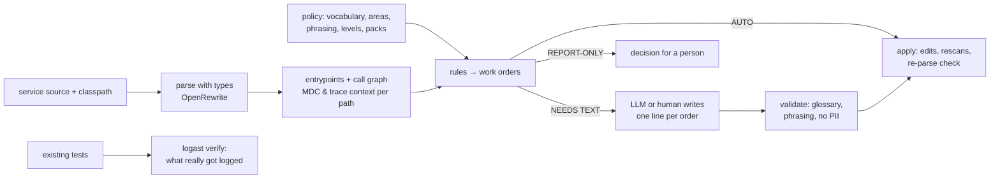

# logast

**Make every Spring Boot service log, trace, measure, fail and audit the same way, in your business's language,
without asking each team to remember the rules.**

logast reads a service's source with full type resolution, follows the call graph from every entrypoint (HTTP
endpoints, schedulers, listeners, batch runners) and finds where logging, MDC context, tracing and metrics fall short
of your standard. Each finding is a **work order**: a concrete, pre-decided code change. Most apply automatically.
Where a message has to be worded, a person or an LLM writes **one line of text**, and logast checks it against your
vocabulary and phrasing rules before writing anything.

What a service gets out of it:

- structured JSON logs in the format you choose (`logging.structuredFormat`: ECS by default, Logstash, GELF or your own
  formatter) with the service name and version, and no hand-rolled `logback-spring.xml`;
- the business ids (`order.id`, `tenant.id`, …) in MDC from the entrypoint down, scoped with try-with-resources, and
  never leaking into the next request on a pooled thread;
- traces that survive `@Async`, executors, HTTP calls between services, messaging, and orchestrator → batch-pod launches;
- log lines in one format and one vocabulary: `Payment charge failed [order.id=…]`, never
  `"Error while charging " + id`;
- exceptions logged once, where they are handled, and never swallowed silently;
- meter names and tags that don't explode your metrics backend, and business events that are measured;
- timeouts on every outgoing call, bounded thread pools, messages that are not silently dropped;
- error responses that don't leak internals, and business exceptions that don't turn into 500s;
- an audit record for every action that must have one;
- a compliance score per service, and CI that fails only on *new* problems.

**Works with** Spring Boot 3 and 4 services on Java 17+, built with Gradle, logging through SLF4J + Logback, tracing
with Micrometer Tracing / OpenTelemetry. logast itself runs on Java 21+ (25 recommended).

**See it in code:** [docs/examples.md](docs/examples.md) shows before/after snippets for each pack.

---

## How it works



- **The tool decides, the writer only writes.** Where to log, at what level, which values, which MDC scope, which
  import: all of it is decided by logast. The LLM, or a person in `logast review`, only supplies message text, so the
  result is repeatable, cheap and safe to run in CI.
- **Paths, not single files.** "Is `order.id` in MDC here?" is answered for every path that reaches the line, across
  interfaces, lambdas, async hops and filters. A value already in MDC is never repeated in a message.
- **A runtime starter does the plumbing.** Generated code calls a small library, `logging-support`, instead of
  repeating boilerplate ([below](#the-runtime-starter)).

---

## Install

**From source** (needs a JDK 21+ on `PATH`):

```bash
git clone https://github.com/magyar-attila-317/logast.git && cd logast
./install.sh --skill --starter
logast --version
```

**From a release zip:** `./install.sh --zip logast-<version>.zip`, or unzip it anywhere and put its `bin/` on `PATH`.

**In a service's build (scan and CI gate only):** `plugins { id("dev.logast") version "<version>" }`, then
`./gradlew logastScan` or `logastCheck`; setup and publishing in [docs/gradle-plugin.md](docs/gradle-plugin.md).

| `install.sh` option | what it does |
|---|---|
| *(none)* | builds the CLI, installs it to `~/.local/share/logast` and links `~/.local/bin/logast` |
| `--skill` | installs the Claude Code skill to `~/.claude/skills/logast/SKILL.md`, so Claude Code knows the workflow |
| `--starter` | publishes `dev.logast:logging-support` and `dev.logast:test-capture` to Maven Local (`~/.m2`) |
| `--zip <file>` | installs a release zip instead of building |

- `LOGAST_HOME` / `LOGAST_BIN` override the install locations.
- **Update:** pull and run `./install.sh` again. It replaces the installed copy and refreshes an installed skill; add
  `--starter` when the starter changed.
- **macOS:** install a JDK first (`brew install openjdk@21`, SDKMAN or Temurin); the `/usr/bin/java` stub alone is not
  a JDK. `~/.local/bin` is not on the macOS `PATH` by default: add `export PATH="$HOME/.local/bin:$PATH"` to
  `~/.zshrc`, or install elsewhere with `LOGAST_BIN=/opt/homebrew/bin ./install.sh`.

---

## Quick start

In the service's root folder:

```bash
logast init .                    # 1. once: logast.yaml, .gitignore, classpath, traffic.yaml
                                 # 2. review logast.yaml: organise the business terms it found
logast apply . --auto --write    # 3. changes the code, creates the files to fill in
                                 # 4. fill in .logast/decisions/messages.yaml and .logast/decisions/metrics.yaml
logast apply . --auto --write    # 5. again, on the migrated code: writes what you filled in
git diff                         # 6. review
```

- `apply` without `--write` only previews the diff.
- One `apply` does everything automatic; the second is only for what you filled in. Don't revert the code before
  it: the entries in the files point at the migrated code.
- `init` prints a numbered **Next steps** list; `apply` and `scan` end with what is left, grouped by what you do
  about it ([what happens next](docs/commands.md#what-happens-next)).
- More packs from the start: `logast init . --pack logging,tracing,metrics,resilience,errors,audit`.

---

## The workflow

### What a finding asks of you

| kind | who acts | how |
|---|---|---|
| **AUTO** | logast | `apply --auto` makes the change |
| **NEEDS TEXT** | a person or an LLM | write one message in `.logast/decisions/messages.yaml` (or in `logast review . --open`); the next `apply` validates and writes it |
| **REPORT-ONLY** | a person | a decision logast does not make; the finding says what to decide and when it counts as done |

Metric decisions (count an outcome, tag it, or skip it) go into `.logast/decisions/metrics.yaml` the same way.

### Who writes the text

- **A person:** `logast review . --open` opens a local page with one input per message, the code, the path from the
  entrypoint and the required phrasing.
- **An LLM:** with the skill installed, ask Claude Code *"bring this service's logging to the standard"*; it follows
  [docs/llm-workflow.md](docs/llm-workflow.md).

### The files it writes

`.logast/decisions/` holds what you decide (YAML, you edit it, it goes into git); `.logast/reports/` holds what logast
writes for you to read. `init` adds `.logast/*` to `.gitignore`, keeping the decisions, the baseline and the README in
git. A `.logast` from an earlier logast version is moved into this layout by the next command (one line says what moved).

| file | what it is | written by | in git? |
|---|---|---|---|
| `logast.yaml` | your settings; every option is explained in comments inside the file | `init` | yes |
| `.logast/README.md` | what each file in the folder is for | `init` | yes |
| `.logast/decisions/messages.yaml` | message texts to write; kept in step with the code (entries kept, added, removed when done) | `scan`, `apply` | yes |
| `.logast/decisions/metrics.yaml` | metric decisions to make, kept in step the same way | `scan`, `apply` | yes |
| `.logast/decisions/traffic.yaml` | every entrypoint, with calls/day if you fill them in (judges log volume) | `init`, `traffic`, `apply` | yes |
| `.logast/decisions/retry.yaml` | every `@Retryable` usage, to mark the ones that need settings of their own (resilience pack) | `scan`, `apply` | yes |
| `.logast/baseline.json` | the findings CI accepts as known | `init --baseline`, `scan --update-baseline` | yes |
| `.logast/classpath-*.txt` | the service's compile classpath, so logast understands types (Gradle runs once, nothing is compiled) | `init`, `classpath`; `apply` after a build-file change | no (machine-specific) |
| `.logast/reports/orders.json` | the last scan's work orders, in full | `scan` | no |
| `.logast/reports/coverage.txt` | every log call and what logast did with it: fixed, reported, ignored, skipped (with the reason) or checked ([details](docs/commands.md#every-log-call-is-accounted-for)) | `scan`, `apply --write` (logging pack) | no |
| `.logast/reports/steps/*.diff` | one diff per apply step, to review or drop a kind of change | `apply` | no |
| `.logast/reports/apply-trace.txt` | what each apply round did and what its rescan found | `apply` | no |
| `.logast/reports/queries.md` | dashboard and alert queries for the service | `queries` | no |
| `.logast/reports/verify.json` | the last `verify` result | `verify` | no |

Details of every command, with example output: [docs/commands.md](docs/commands.md).

---

## Packs

Rules come in six packs. `logging` and `tracing` run by default; the others are opt-in (`packs:` in `logast.yaml`, or
`--pack`).

| pack | what it covers |
|---|---|
| [logging](docs/packs/logging.md) | message format and vocabulary, exceptions logged once, business ids in MDC, what goes into a line, log lines where flows are silent, levels and volume |
| [tracing](docs/packs/tracing.md) | the trace across threads, HTTP calls, messaging and launched jobs; spans that end and carry errors; traces that reach a backend; trace ids in logs |
| [metrics](docs/packs/metrics.md) | business events and outcomes that are measured; meter names and tags that stay bounded; service and version on every meter |
| [resilience](docs/packs/resilience.md) | timeouts, bounded pools and waits, retries that run, scheduled-job locks, graceful shutdown, health probes |
| [errors](docs/packs/errors.md) | error responses that don't leak internals, exceptions mapped to the right status, the trace id in error bodies, causes kept |
| [audit](docs/packs/audit.md) | audit records that exist, say who, what and with which outcome, are written after commit and routed apart |

Every rule, its severity and how it is fixed: [docs/rules.md](docs/rules.md) (`logast rules` lists them from the code).
Silence one finding with `// logast:ignore RULE` on the line or the line above.

---

## Configuration

`logast init` writes a `logast.yaml` that explains itself. You only write what differs from the defaults, and a
service can build on shared company layers:

```yaml
extends: [https://git.example.com/platform/observability/raw/main/company.yaml]

logging:
  rewriteExistingMessages: false   # legacy service: fix structure, keep the wording

vocabulary:
  order:
    aliases: [ordr]                # added to the company's aliases
```

- Every setting, with its default: [docs/configuration.md](docs/configuration.md).
- Vocabulary, layers, phrasing and levels: [docs/vocabulary.md](docs/vocabulary.md). The vocabulary starts from
  your code: `init` collects the keys the service already uses, one term each, for you to organise.
- A complete company layer: [examples/restaurant-company.yaml](examples/restaurant-company.yaml).
- `logast policy .` prints the merged result and every override.

---

## CI

```bash
logast scan . --baseline --fail-on high --format summary         # only findings that aren't in the baseline
logast scan . --since origin/main --format sarif > logast.sarif  # changed lines only, as PR annotations
```

| exit code | meaning |
|---|---|
| 0 | nothing at or above `--fail-on` |
| 2 | findings at or above `--fail-on` (also: an unknown `--rule`) |
| 3 | `--baseline` given, but no baseline file |
| 4 | `--fail-on` with an incomplete analysis (files that did not parse, no classpath): a broken analysis finds less and must not pass |

- Record the baseline once with `logast init --baseline` or `logast scan . --update-baseline`, and commit
  `.logast/baseline.json`.
- Against a baseline, a known finding that covers more places than when it was recorded (a second unlocked
  `@Scheduled` job) counts as new.
- A complete GitHub Actions job: [examples/github-actions.yml](examples/github-actions.yml).
- With the Gradle plugin the gate is `./gradlew logastCheck`, and `./gradlew logastSarif` writes the SARIF file for
  PR annotations ([docs/gradle-plugin.md](docs/gradle-plugin.md)).

---

## The runtime starter

`logging-support` is a small Spring Boot starter the generated code calls: `ObservedContext`, `MdcScope`,
`ContextExecutors`, `TraceContextEnv`, a context-propagating `TaskDecorator`, and more.

- **It switches nothing on by itself.** Each behaviour has a `logging-support.*.enabled` property, off unless
  `true`; logast writes the ones a pack uses into `application.yml`.
- A service either depends on it (`support.mode: dependency`, the default) or gets its classes copied in
  (`support.mode: vendor`, until the starter is in your repository).

Properties, modes and publishing it to your repository: [docs/starter.md](docs/starter.md).

---

## Documentation

| page | what is in it |
|---|---|
| [docs/examples.md](docs/examples.md) | before/after code: what `logast apply` changes, per pack |
| [docs/commands.md](docs/commands.md) | every command, its options and example output |
| [docs/rules.md](docs/rules.md) | packs and rules: severity, what each finds, how it is fixed |
| [docs/configuration.md](docs/configuration.md) | every `logast.yaml` setting |
| [docs/gradle-plugin.md](docs/gradle-plugin.md) | the `dev.logast` Gradle plugin, the CI gate and PR annotations (SARIF) |
| [docs/vocabulary.md](docs/vocabulary.md) | vocabulary, policy layers, phrasing, levels, log volume |
| [docs/starter.md](docs/starter.md) | the runtime starter |
| [docs/llm-workflow.md](docs/llm-workflow.md) | the loop an LLM follows (installed as the Claude Code skill) |
| [docs/troubleshooting.md](docs/troubleshooting.md) | symptoms and fixes, known limitations |
| [docs/pipeline-plan.md](docs/pipeline-plan.md) | design: the ordered apply steps |

---

## Development

```bash
./gradlew build              # all modules and unit tests
./gradlew :cli:installDist   # cli/build/install/logast/bin/logast
./gradlew :cli:distZip       # release zip with docs, examples and the Claude Code skill
```

| module | contents |
|---|---|
| `core` | parsing, call graph and path context, policy loader, rules, work orders, apply, verify, fleet, review |
| `cli` | the `logast` command |
| `gradle-plugin` | the `dev.logast` Gradle plugin; TestKit tests: `./gradlew :gradle-plugin:functionalTest` |
| `logging-support` | the runtime starter used by generated code |
| `test-capture` | log capture added to test runs by `logast verify` |
| `fixtures/sample-app` | a shop app with planted gaps; `// expect: RULE` markers are checked exactly by the tests |

**End-to-end tests.** `e2e/before` is a small service with the code shapes real services showed. Each scenario runs
`logast apply . --auto --write` on a copy, compiles the result and compares every file and the printed output with a
snapshot in `e2e/expected*`.

```bash
./gradlew :cli:e2e --tests "*Name*"   # the scenarios a change touches (JDK 25)
./gradlew :cli:e2eJdk21               # the same on Java 21
./gradlew build -Pe2e                 # build plus both e2e tasks (CI runs them on Linux and macOS)
./gradlew :cli:e2e -Pe2e.update       # rewrite the snapshots after an intended change; review git diff e2e/
```

Rules for changes (every change comes with a test that fails without it, issues, the e2e matrix):
[AGENTS.md](AGENTS.md).

## License

[Apache License 2.0](LICENSE): use, fork, change and redistribute it, also commercially. Copies and derivative works
keep the license and the [NOTICE](NOTICE) file, which names logast as their source, and say what they changed.
